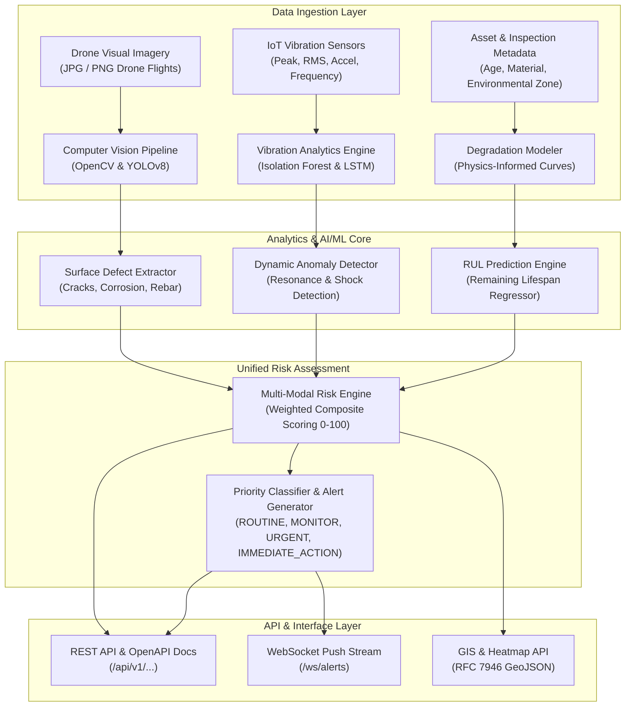

# STRUCTURA AI – Autonomous Infrastructure Health Monitoring and Structural Integrity Prediction System

[](https://www.python.org/)
[](https://fastapi.tiangolo.com/)
[](https://pytorch.org/)
[](https://opencv.org/)
[]()
[]()

STRUCTURA AI is an autonomous, AI-driven infrastructure monitoring and predictive maintenance backend built for high-stakes civil assets including bridges, dams, and highway overpasses. The system integrates aerial drone imagery computer vision, dynamic IoT vibration telemetry anomaly detection, physics-informed Remaining Useful Life (RUL) forecasting, and multi-modal risk scoring.

---

## 1. System Architecture



---

## 2. Technology Stack

- **Backend Framework**: Python 3.11+, FastAPI, Starlette, Uvicorn (ASGI)
- **Data Validation & Schemas**: Pydantic v2, Pydantic-Settings
- **ORM & Relational Database**: SQLAlchemy 2.0 (PostgreSQL + PostGIS in production, SQLite fallback in development)
- **Computer Vision & Image Processing**: OpenCV (`opencv-python-headless`), Pillow, Ultralytics YOLOv8
- **Machine Learning & Deep Learning**:
  - `PyTorch`: LSTM Autoencoder for temporal sequence anomaly detection
  - `Scikit-Learn`: Isolation Forest anomaly detector & Gradient Boosting RUL degradation regressor
  - `NumPy` & `Pandas`: Mathematical statistics, RMS, crest factor, and feature extraction
- **Communication Protocols**: REST APIs, WebSockets (`/ws/alerts` live broadcast)
- **Testing & Quality Assurance**: Pytest, FastAPI TestClient (`httpx`)
- **Containerization**: Docker, Docker Compose

---

## 3. Git Branch-Wise Development Workflow

The codebase was engineered following strict Git branch-wise development guidelines:
- `main`: Production-ready release branch.
- `develop`: Primary integration branch.
- Feature branches (each independently implemented, tested, and non-fast-forward merged into `develop`):

```
main
  |
  develop
  |
  |-- feature/auth-api          (Commit c24f88b: JWT authentication, RBAC, registration/login)
  |-- feature/database          (Commit 83b2e5d: SQLAlchemy relational models, cascading & indexes)
  |-- feature/vision-ai         (Commit 5b4a296: OpenCV + YOLOv8 defect detection & annotation)
  |-- feature/sensor-ai         (Commit 0ea64da: Vibration telemetry, Isolation Forest, PyTorch LSTM)
  |-- feature/rul-prediction    (Commit 6c1ee12: ML physics-informed RUL forecasting & disclaimers)
  |-- feature/risk-engine       (Commit d1ba36b: Multi-modal 0-100 health scoring & alerts)
  |-- feature/geospatial-api    (Commit 868b5cc: RFC 7946 GeoJSON features & risk heatmap)
  |-- feature/dashboard-api     (Commit 7611209: React dashboard endpoints & WebSocket streaming)
```

---

## 4. Implemented Features vs. Simulated / Fallback Features

In accordance with engineering ethics and hackathon evaluation criteria, the system maintains complete transparency between genuine production models and prototype fallbacks:

| Module | Implemented Core Features | Transparent Fallback / Prototype Mode |
| :--- | :--- | :--- |
| **Authentication & RBAC** | • Full bcrypt password hashing<br>• Signed HS256 JWT tokens with role claims<br>• Route-level RBAC (`admin`, `inspector`, `user`) | *None (Fully production-grade).* |
| **Relational Database** | • SQLAlchemy 2.0 ORM models<br>• Foreign key cascade constraints<br>• Database indexes on query coordinates & timestamps<br>• Multi-dialect support (SQLite & PostgreSQL) | *Development defaults to SQLite if PostgreSQL container is unconfigured.* |
| **Computer Vision AI** | • File format & size validation (JPG/PNG <= 15MB)<br>• OpenCV image processing (Canny edge detection, adaptive contours, HSV rust color masking)<br>• YOLOv8 model loading interface<br>• Visual annotation engine with severity color-coding and banners | • When custom trained weights (`models/yolov8_defects.pt`) are unmounted, seamlessly activates `OpenCVDemoVisionDetector`<br>• Clearly marked with `is_simulated_mode: true` and watermark. |
| **IoT Sensor Analytics** | • Mean, Standard Deviation, RMS, Peak, and Crest Factor calculation<br>• Production `IsolationForest` anomaly classifier<br>• Full PyTorch `LSTMAutoencoder` architecture (Encoder, Latent Bottleneck, Decoder, Reconstruction Loss) | • Synthetic sensor telemetry generator (`/simulate`) to demonstrate anomaly detection without physical IoT hardware. |
| **Remaining Useful Life (RUL)** | • Non-linear `GradientBoostingRegressor`<br>• Physical degradation interaction (age ratio, cyclic stress exponent, environmental factors)<br>• Automated database feature aggregation | • Trained on synthetic physics-informed degradation baselines (AASHTO/Eurocode curves)<br>• Labeled with mandatory engineering safety disclaimer. |
| **Risk Assessment Engine** | • Weighted composite 0-100 health scoring<br>• Safety override caps for critical defects/vibrations<br>• Actionable priority mapping (`ROUTINE` to `IMMEDIATE_ACTION`)<br>• Automatic alert dispatch | • Algorithmic triage indicator (explicitly declared as not a PE certified sign-off). |
| **Geospatial API** | • RFC 7946 GeoJSON FeatureCollections (`[lng, lat]` coordinates)<br>• Geo-located defect mapping<br>• Heatmap density layers with bounding box calculation | *None (Standard GIS specification).* |
| **Dashboard & WebSockets** | • React-tailored analytics aggregations<br>• Live asynchronous WebSocket broadcast manager (`/ws/alerts`)<br>• Alert lifecycle management (ACTIVE -> ACKNOWLEDGED -> RESOLVED) | *None (Full real-time streaming).* |

---

## 5. Project Folder Structure

```
STRUCTURA AI/
├── backend/
│   ├── app/
│   │   ├── main.py                     # FastAPI application entry & WebSocket route
│   │   ├── core/
│   │   │   ├── config.py               # Pydantic BaseSettings & environment config
│   │   │   ├── security.py             # Bcrypt hashing & PyJWT token utilities
│   │   │   └── database.py             # SQLAlchemy engine & session factory
│   │   ├── api/
│   │   │   ├── deps.py                 # JWT & RBAC dependency injection
│   │   │   └── routes/
│   │   │       ├── auth.py             # User registration, login, profile routes
│   │   │       ├── infrastructure.py   # Infrastructure asset CRUD endpoints
│   │   │       ├── vision.py           # Drone image defect detection endpoints
│   │   │       ├── sensors.py          # Vibration telemetry & anomaly endpoints
│   │   │       ├── prediction.py       # RUL prediction & history endpoints
│   │   │       ├── risk.py             # Multi-modal risk assessment endpoints
│   │   │       ├── geospatial.py       # RFC 7946 GeoJSON & heatmap endpoints
│   │   │       └── dashboard.py        # React dashboard summary & analytics endpoints
│   │   ├── models/                     # SQLAlchemy relational ORM models
│   │   │   ├── user.py
│   │   │   ├── infrastructure.py
│   │   │   ├── defect.py
│   │   │   ├── sensor.py
│   │   │   ├── prediction.py
│   │   │   └── alert.py
│   │   ├── schemas/                    # Pydantic validation & response schemas
│   │   │   ├── common.py
│   │   │   ├── auth.py
│   │   │   ├── infrastructure.py
│   │   │   ├── vision.py
│   │   │   ├── sensors.py
│   │   │   ├── prediction.py
│   │   │   ├── risk.py
│   │   │   ├── geospatial.py
│   │   │   └── dashboard.py
│   │   ├── services/                   # Business logic service layer
│   │   │   ├── vision/service.py
│   │   │   ├── sensors/service.py
│   │   │   ├── prediction/service.py
│   │   │   ├── risk/engine.py
│   │   │   ├── geospatial/service.py
│   │   │   └── dashboard/service.py
│   │   ├── ml/                         # AI/ML algorithms & neural network models
│   │   │   ├── vision/detector.py      # YOLOv8 & OpenCV defect detector
│   │   │   ├── anomaly/
│   │   │   │   ├── statistical.py      # Vibration RMS & crest factor extraction
│   │   │   │   ├── isolation_forest.py # Isolation Forest anomaly detector
│   │   │   │   └── lstm_autoencoder.py # PyTorch LSTM Autoencoder
│   │   │   └── rul/model.py            # Gradient Boosting RUL regressor
│   │   └── websocket/
│   │       └── manager.py              # Real-time WebSocket connection manager
│   ├── uploads/                        # Raw uploaded inspection images
│   ├── processed/                      # Annotated defect images with overlays
│   └── requirements.txt
├── tests/
│   ├── conftest.py                     # Pytest fixtures & isolated in-memory DB
│   ├── test_auth.py                    # Authentication & RBAC test suite
│   ├── test_database.py                # Relational integrity & CRUD test suite
│   ├── test_vision.py                  # Computer vision & OpenCV test suite
│   ├── test_sensors.py                 # Telemetry, Isolation Forest & LSTM test suite
│   ├── test_prediction.py              # RUL regression & degradation test suite
│   ├── test_risk.py                    # Risk assessment engine test suite
│   ├── test_geospatial.py              # GeoJSON & GIS heatmap test suite
│   ├── test_dashboard.py               # Dashboard aggregations & WebSocket test suite
│   └── test_end_to_end_workflow.py     # 10-step full system integration test
├── seed_demo_data.py                   # Automated demo dataset generator
├── Dockerfile                          # Multi-stage production container build
├── docker-compose.yml                  # Backend + PostgreSQL/PostGIS stack
├── .env.example
├── requirements.txt
└── README.md
```

---

## 6. API Reference

All REST endpoints return a uniform standard JSON payload:
```json
{
  "success": true,
  "message": "Operation completed successfully",
  "data": {},
  "timestamp": "2026-10-31T17:00:00.000000+00:00"
}
```

### Key Endpoints

| Category | HTTP Method | Endpoint | Description |
| :--- | :--- | :--- | :--- |
| **Authentication** | `POST` | `/api/v1/auth/register` | Register new user with role assignment (`admin`, `inspector`, `user`). |
| | `POST` | `/api/v1/auth/login` | Authenticate and obtain JWT bearer token. |
| | `GET` | `/api/v1/auth/me` | Fetch authenticated user profile. |
| **Infrastructure** | `POST` | `/api/v1/infrastructure/` | Register a new civil asset (bridge, dam, overpass). |
| | `GET` | `/api/v1/infrastructure/` | List all assets with optional filtering. |
| | `GET` | `/api/v1/infrastructure/{id}` | Get asset details, defect count, and active alerts. |
| | `PUT` | `/api/v1/infrastructure/{id}` | Update infrastructure metadata. |
| | `DELETE`| `/api/v1/infrastructure/{id}` | Cascade delete asset and associated records (Admin only). |
| **Computer Vision** | `POST` | `/api/v1/vision/analyze` | Upload drone image (JPG/PNG), run defect detection, save annotated image. |
| | `GET` | `/api/v1/vision/results/{id}` | Retrieve specific defect detection record. |
| | `GET` | `/api/v1/vision/infrastructure/{id}` | Get all visual defects detected for an asset. |
| **Sensor Analytics**| `POST` | `/api/v1/sensors/data` | Ingest single vibration reading with Isolation Forest anomaly tagging. |
| | `POST` | `/api/v1/sensors/batch` | Ingest batch telemetry; computes RMS, peak, crest factor. |
| | `GET` | `/api/v1/sensors/{id}/readings` | Retrieve historical sensor readings. |
| | `GET` | `/api/v1/sensors/{id}/anomalies` | Retrieve detected vibration anomalies. |
| | `POST` | `/api/v1/sensors/simulate` | Generate synthetic dynamic vibration telemetry for live demo. |
| **RUL Prediction** | `POST` | `/api/v1/prediction/rul` | Forecast Remaining Useful Life using physics-informed ML regression. |
| | `GET` | `/api/v1/prediction/{id}` | Get latest RUL forecast for an asset. |
| | `GET` | `/api/v1/prediction/history/{id}`| Get historical degradation forecasts. |
| **Risk Assessment** | `GET` | `/api/v1/risk/{id}` | In-depth multimodal risk index (0-100) & inspection priority. |
| | `GET` | `/api/v1/risk/summary` | Portfolio-wide risk breakdown. |
| | `GET` | `/api/v1/risk/critical` | List assets requiring URGENT or IMMEDIATE action. |
| **Geospatial API** | `GET` | `/api/v1/geo/infrastructure` | RFC 7946 GeoJSON FeatureCollection of infrastructure with risk markers. |
| | `GET` | `/api/v1/geo/defects` | GeoJSON FeatureCollection of geo-tagged defects. |
| | `GET` | `/api/v1/geo/heatmap` | Intensity-weighted points for GIS heatmaps. |
| **Dashboard** | `GET` | `/api/v1/dashboard/overview` | High-level metrics cards for React frontend. |
| | `GET` | `/api/v1/dashboard/analytics` | Defect category statistics & 24h telemetry trends. |
| | `GET` | `/api/v1/dashboard/alerts` | Alert list with Active/Acknowledged/Resolved counts. |
| | `GET` | `/api/v1/dashboard/infrastructure` | Complete asset table with health scores & component tallies. |
| | `PUT` | `/api/v1/dashboard/alerts/{id}/status` | Acknowledge or resolve an active alert. |
| **WebSockets** | `WS` | `/ws/alerts` | Real-time WebSocket stream broadcasting instant alerts to clients. |

Interactive Swagger documentation is available at `http://localhost:8000/api/v1/docs`.

---

## 7. Setup & Execution Guide

### Prerequisites
- Python 3.11+
- Virtual environment (`venv`)

### 1. Installation
```bash
# Clone or navigate to the project directory
cd "STRUCTURA AI"

# Create and activate virtual environment
python3 -m venv venv
source venv/bin/activate  # On Windows: venv\Scripts\activate

# Install dependencies
pip install -r requirements.txt
```

### 2. Environment Configuration
```bash
cp .env.example .env
```

### 3. Running Test Suite
Execute all 25 automated unit and end-to-end integration tests:
```bash
PYTHONPATH=. pytest tests/ -v
```

### 4. Seed Demo Dataset
Prepopulate Bridge A, Highway Overpass B, Dam C, synthetic inspection images, sensor streams, RUL predictions, and alerts:
```bash
python seed_demo_data.py
```

### 5. Start the Server
Launch the FastAPI ASGI application with live reloading:
```bash
uvicorn backend.app.main:app --reload --port 8000
```
- API Base: `http://localhost:8000`
- Swagger UI Documentation: `http://localhost:8000/api/v1/docs`
- ReDoc Documentation: `http://localhost:8000/api/v1/redoc`
- WebSocket Alerts Endpoint: `ws://localhost:8000/ws/alerts`

### 6. Docker Deployment (Optional)
To run with PostgreSQL + PostGIS:
```bash
docker compose up --build -d
```
